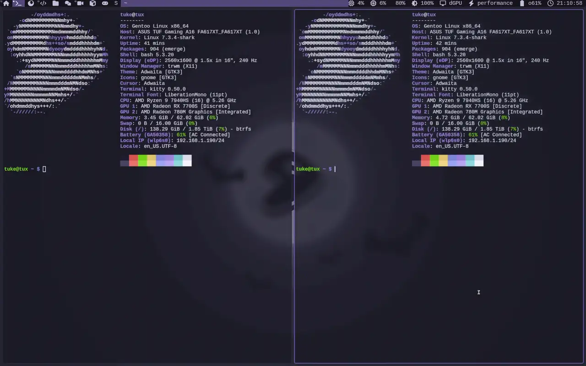
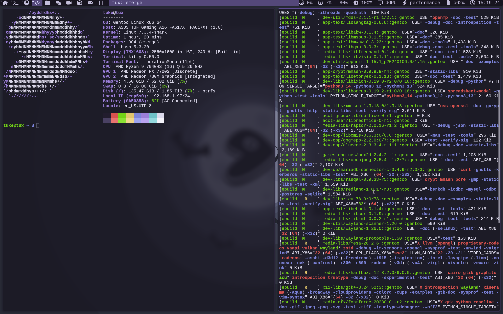

# trwm — tuke's rust window manager

A dynamic tiling window manager for X11, inspired by dwm and written from scratch
in Rust. It includes its own **status bar** (like slstatus) and **screen locker**
(like slock), and it is configured in **Lua**. Changes apply as soon as you save
the config file.



<sub>The `spiral` layout, using tuke's setup: [`examples/tuke.lua`](examples/tuke.lua)</sub>

---

## Quick start (the 2-minute version)

```sh
# 1. install the dependencies for your distro (see "Dependencies" below), then:
git clone https://github.com/TukeCS/trwm ~/.local/src/trwm && cd ~/.local/src/trwm
cargo install --path .

# 2. check your setup: lists anything missing and how to install it
trwm doctor

# 3. (recommended) PAM file for the screen locker
sudo install -m644 extra/trwm.pam /etc/pam.d/trwm

# 4. start it: put this at the end of ~/.xinitrc, then run `startx`
exec trwm
```

The first time trwm starts, it writes your config to `~/.config/trwm/config.lua` and shows
the most important keys in the bar. That file explains every option, with everything that's
off by default commented out, so reading it is the quickest way to learn what trwm can do.

**The keys you need first** (`Mod` is the Super/Windows key):

| key | does |
|---|---|
| `Mod+Return` | open a terminal |
| `Mod+p` | app launcher (rofi) |
| `Mod+j` / `Mod+k` | focus next / previous window |
| `Mod+r` | switch between the spiral and dwindle layouts |
| `Mod+1` … `Mod+9` | switch to tag (workspace) 1–9 |
| `Mod+Shift+1` … `9` | move the window to tag 1–9 |
| `Mod+Shift+c` | close the window |
| `Mod+=` / `Mod+-` | bigger / smaller gaps |
| `Mod+Shift+l` | lock the screen |
| `Mod+Shift+q` | quit trwm |

To change something, edit `~/.config/trwm/config.lua` and save it. The change applies
immediately. If the config has a mistake, trwm keeps the old config and shows the error
in the bar. If something doesn't work, run `trwm doctor`.

---

## Contents

- [Features](#features)
- [Dependencies](#dependencies)
- [Installing](#installing)
- [Starting trwm](#starting-trwm)
- [Using trwm](#using-trwm)
- [Configuration](#configuration)
- [Status bar](#status-bar)
- [Screen locker](#screen-locker)
- [Wallpaper](#wallpaper)
- [Controlling trwm from scripts](#controlling-trwm-from-scripts)
- [Command line](#command-line)
- [Troubleshooting](#troubleshooting)

---

## Features

- **Easy setup:** `trwm doctor` checks your system and tells you how to fix what's missing,
  trwm writes its config on first start, that config explains every option, and your
  editor autocompletes it
- **dwm-style tiling:** tags, master/stack layout, monocle, floating windows,
  multiple monitors (Xinerama), urgency hints, fullscreen (EWMH), dialogs float automatically,
  and you can move/resize windows with the mouse (with edge snapping)
- **Hyprland-style split layouts:** `dwindle` and `spiral`, where a new window splits the
  window under your cursor, plus `bstack`, `grid` and `deck`
- **Auto-tiling helpers:** `retile()` snaps every window you floated back into the tiling,
  `drag_tiled = "swap"` lets you drag tiled windows to swap them instead of floating them,
  and `togglelayout()` flips between two layouts on one key
- **Gaps:** on by default. Change them live with `Mod+=` / `Mod+-`. With "smart gaps",
  a single window fills the screen without an outer gap
- **Built-in status bar:** CPU, RAM, battery, temperature, disk, network, date and more,
  read straight from `/proc` and `/sys`. Shell commands run in the background, so a slow
  script can never freeze the WM
- **Built-in screen locker:** checks your password with PAM. It uses slock-style colours
  and can show a clock, turn the monitor off and lock automatically when you are idle
- **Wallpaper with feh:** one image, or a random one from a folder, rotating on a timer if you want
- **Lua config with hot reload:** key bindings are plain Lua functions, so you can script anything
- **`Mod+Shift+r`** restarts trwm in place (for example after rebuilding it), and every window stays on its tag

---

## Dependencies

To **build** trwm you need:

| what | why |
|---|---|
| Rust **1.88 or newer** + cargo | the compiler |
| a C compiler + pkg-config | trwm builds Lua 5.4 from source, so you don't need Lua installed |
| libX11, libXft, libXinerama, libXss, libXext, libXrandr, libXcursor, libxkbfile, libXi | X11, fonts, multi-monitor, idle detection, DPMS, DPI, cursors, keyboard layouts, mouse/touchpad settings |
| PAM (development files) | the screen locker checks your password with it |

**At runtime** it uses:

| what | why |
|---|---|
| `kitty` | the terminal in the default config |
| `rofi` | the app launcher in the default config |
| `feh` | sets the wallpaper (optional, off by default) |
| `xss-lock` | locks the screen on suspend (optional) |

You can swap kitty and rofi for any other programs in the config.

> **Rust version:** if your distro's Rust is older than 1.88 (`rustc --version`), install
> it with [rustup](https://rustup.rs) instead:
> `curl --proto '=https' --tlsv1.2 -sSf https://sh.rustup.rs | sh`

### Gentoo

```sh
sudo emerge --ask dev-lang/rust-bin dev-util/pkgconf \
    x11-libs/libX11 x11-libs/libXft x11-libs/libXinerama \
    x11-libs/libXScrnSaver x11-libs/libXext x11-libs/libXrandr x11-libs/libXcursor x11-libs/libxkbfile x11-libs/libXi sys-libs/pam media-gfx/feh
```

(Use `dev-lang/rust` instead of `rust-bin` to compile Rust yourself.)

### Arch Linux / Manjaro / EndeavourOS

```sh
sudo pacman -S --needed base-devel rust libx11 libxft libxinerama libxss libxext libxrandr libxcursor libxkbfile libxi pam feh
```

### Debian / Ubuntu / Linux Mint / Pop!_OS

```sh
sudo apt install build-essential pkg-config \
    libx11-dev libxft-dev libxinerama-dev libxss-dev libxext-dev libxrandr-dev libxcursor-dev libxkbfile-dev libxi-dev libpam0g-dev feh
# Rust: the packaged version is usually too old, so use rustup (see above)
```

### Fedora

```sh
sudo dnf install gcc pkgconf-pkg-config rust cargo \
    libX11-devel libXft-devel libXinerama-devel libXScrnSaver-devel libXext-devel \
    libXrandr-devel libXcursor-devel libxkbfile-devel libXi-devel pam-devel feh
```

### openSUSE

```sh
sudo zypper install gcc pkg-config rust cargo \
    libX11-devel libXft-devel libXinerama-devel libXss-devel libXext-devel \
    libXrandr-devel libXcursor-devel libxkbfile-devel libXi-devel pam-devel feh
```

### Void Linux

```sh
sudo xbps-install -S base-devel pkg-config rust cargo \
    libX11-devel libXft-devel libXinerama-devel libXScrnSaver-devel libXext-devel \
    pam-devel feh
```

### Alpine

```sh
sudo apk add build-base pkgconf rust cargo \
    libx11-dev libxft-dev libxinerama-dev libxscrnsaver-dev libxext-dev \
    libxrandr-dev libxcursor-dev libxkbfile-dev libxi-dev linux-pam-dev feh
```

### NixOS

```sh
nix-shell -p cargo rustc pkg-config xorg.libX11 xorg.libXft xorg.libXinerama \
    xorg.libXScrnSaver xorg.libXext xorg.libXrandr xorg.libXcursor xorg.libxkbfile xorg.libXi pam feh
```

---

## Installing

```sh
cd ~/.local/src/trwm
cargo install --path .          # installs to ~/.cargo/bin/trwm
```

Make sure `~/.cargo/bin` is in your `PATH`. To install system-wide instead:

```sh
cargo build --release
sudo install -m755 target/release/trwm /usr/local/bin/trwm
```

Then check that everything is in place, and install the PAM file for the locker
(recommended):

```sh
trwm doctor
sudo install -m644 extra/trwm.pam /etc/pam.d/trwm
```

You don't need to create a config: trwm writes `~/.config/trwm/config.lua` the first time it
starts. To start over with the default later, run
`trwm default-config > ~/.config/trwm/config.lua`.

### `trwm doctor`

`trwm doctor` checks everything trwm needs and tells you how to fix what's missing, with the
install command for your distro:

- **Config:** does it load without errors? Does the wallpaper exist?
- **Programs:** every program your keys, autostart and status bar start (terminal,
  launcher, …), including ones started inside a terminal like `kitty -e yazi`.
- **Fonts:** are they really installed, or would another font be used instead?
- **Lock screen:** is `/etc/pam.d/trwm` set up? (Important on distros with `pam_faillock`.)
- **X server:** the extensions trwm uses, and which window manager is running.
- **Keyboard, monitor and mouse settings:** are the layout and output names valid?
- **PATH and startup:** can `trwm` be found, and does `.xinitrc` or a display manager start it?

Run it from a terminal inside your X session for the full check. It exits with an error code
when it finds a problem, so scripts can use it too.

**Your own config is never overwritten:** trwm reads `~/.config/trwm/config.lua`. The
`config.lua` in this repo is only the default you start from.

**Updating:** `git pull && cargo install --path .`, then press `Mod+Shift+r` to switch to the
new version without closing any windows.

---

## Starting trwm

### With startx / xinit

`~/.xinitrc`:

```sh
#!/bin/sh
[ -f ~/.Xresources ] && xrdb -merge ~/.Xresources
dunst &                        # notifications (optional)
picom -b &                     # compositor (optional)
xss-lock -- trwm lock &        # lock on suspend / screen blank (optional)
exec trwm
```

You don't need `slstatus`, `slock` or `~/.fehbg` any more, because trwm handles all three.
Programs can also be started from the `autostart` list in the config.

### With a display manager (LightDM, SDDM, GDM, ly…)

```sh
sudo cp extra/trwm.desktop /usr/share/xsessions/
```

Then pick **trwm** in the session menu at login.

---

## Using trwm

### The basic ideas

- **Tiling:** new windows split the screen automatically. By default trwm uses the
  **spiral** layout: each new window splits the window under your mouse cursor in two, like
  Hyprland. If you prefer dwm's classic layout, with one big **master** window on the left
  and the rest **stacked** on the right, set `default_layout = "tile"` in your config.
- **Tags** are like workspaces, but more flexible: a window can be on several tags, and you
  can view several tags at once.
- **Bar:** the tags are on the left, then the layout symbol and the focused window's title.
  The status is on the right. A small square on a tag means it has windows.

### All default keys

`Mod` = Super (Windows key). You can change it with `modkey` in the config.

**Programs**

| key | does |
|---|---|
| `Mod+Return` | terminal (kitty) |
| `Mod+p` | launcher (rofi) |

**Windows**

| key | does |
|---|---|
| `Mod+j` / `Mod+k` | focus next / previous window |
| `Mod+Shift+Return` | swap the focused window with the master |
| `Mod+h` / `Mod+l` | shrink / grow the master area |
| `Mod+i` / `Mod+d` | more / fewer windows in the master area |
| `Mod+Shift+space` | toggle floating for the window |
| `Mod+Shift+f` | toggle fullscreen |
| `Mod+Shift+c` | close the window |

**Layouts**

| key | layout |
|---|---|
| `Mod+r` | `S` spiral (default) ↔ `D` dwindle: the split layouts, like Hyprland |
| `Mod+t` | `[]=` tile: dwm's master and stack |
| `Mod+m` | `[M]` monocle: one window at a time, fullscreen-ish |
| `Mod+f` | `><>` floating |
| `Mod+space` | switch back to the previous layout |

The `bstack`, `grid` and `deck` layouts are built in too. Add them to `layouts` in your
config and give them keys (see [Layouts](#layouts)).

**Tags**

| key | does |
|---|---|
| `Mod+1`…`9` | view tag |
| `Mod+Shift+1`…`9` | move window to tag |
| `Mod+Ctrl+1`…`9` | also show that tag alongside the current one |
| `Mod+Ctrl+Shift+1`…`9` | also put the window on that tag |
| `Mod+0` | view all tags |
| `Mod+Shift+0` | put the window on all tags (sticky) |
| `Mod+Tab` | back to the previous tag |

**Gaps**

| key | does |
|---|---|
| `Mod+=` | bigger gaps |
| `Mod+-` | smaller gaps |
| `Mod+g` | gaps on / off |
| `Mod+Shift+g` | reset gaps to the configured size |

**Monitors**

| key | does |
|---|---|
| `Mod+,` / `Mod+.` | focus previous / next monitor |
| `Mod+Shift+,` / `Mod+Shift+.` | send the window to the previous / next monitor |

**trwm**

| key | does |
|---|---|
| `Mod+b` | hide / show the bar |
| `Mod+Shift+l` | lock the screen |
| `Mod+Ctrl+r` | reload the config (it also reloads automatically on save) |
| `Mod+Shift+r` | restart trwm in place, keeping all windows |
| `Mod+Shift+q` | quit |

### Mouse

| action | does |
|---|---|
| `Mod` + left drag | move a window (it becomes floating; with `drag_tiled = "swap"` it swaps places with the window you drop it on) |
| `Mod` + right drag | resize a window |
| `Mod` + middle click | toggle floating |
| click a tag | view it |
| right-click a tag | also show it alongside the current tag |
| `Mod` + click a tag | move the focused window there |
| click the layout symbol | toggle the previous layout |
| right-click the layout symbol | monocle |

---

## Configuration

The config lives at `~/.config/trwm/config.lua`. trwm writes it the first time it starts,
from the default [`config.lua`](config.lua) in this repo. **That file is also the manual:**
every option is in it with an explanation, and everything that's off by default is commented
out, so you turn a feature on by removing the `--` in front of it.

- **Hot reload:** saving the file (or any other `.lua` file in `~/.config/trwm/`) applies
  it immediately.
- **Errors are safe:** if the config has an error, trwm keeps the last working config and
  shows the error in the bar. `trwm check` shows the full error in your terminal.
- **Split it up:** `require("keys")` loads `~/.config/trwm/keys.lua`.

### Autocomplete in your editor

trwm writes two files next to your config when it starts: `types/trwm.lua`, which
describes every option and `trwm.*` function, and `.luarc.json`, which tells the
editor to use it. With an editor that uses the **Lua language server** (Neovim with
`lua_ls`, VS Code with the Lua extension, Helix, Zed, …) you get:

- **Autocomplete** for every option, with a short explanation of each.
- **Errors while you type** for wrong values (`accel = "fast"`), misspelled actions
  (`a.spwan`) and wrong types.
- **No more "undefined global `trwm`"** warnings.

The `---@type trwm.Config` line above `return {` in the config turns this on. The
types file is updated when trwm is; `.luarc.json` is only written if you don't have
one. `trwm types` writes them by hand.

Misspelled option names, like `tapp = true` instead of `tap = true`, are caught by trwm
itself: `trwm check` (and the bar, when you save) says
`unknown option 'tapp' in touchpad (did you mean 'tap'?)`.

### Example config

[`examples/tuke.lua`](examples/tuke.lua) is a full personal setup to get ideas from. It
has a custom colour theme, Nerd Font icons, gaps, HiDPI settings, the Hyprland-like
spiral/dwindle setup described under [Layouts](#a-hyprland-like-setup), keyboard, mouse,
touchpad, monitor and screen blanking settings, window rules, media/brightness keys,
screenshots, a wallpaper and autostart. To try it:

```sh
cp examples/tuke.lua ~/.config/trwm/config.lua
```

The comment at the top of the file lists the programs it expects. This is what it looks
like:



### The basics

```lua
local a = trwm.action

return {
  modkey   = "Super",                -- "Super" or "Alt"
  fonts    = { "monospace:size=10" },  -- add more fonts as fallbacks, e.g. a Nerd Font for icons
  borderpx = 1,
  gaps     = { inner = 10, outer = 10, smart = true },
  tags     = { "1", "2", "3", "4", "5", "6", "7", "8", "9" },  -- any text, emoji or icons
  colors   = {
    norm = { fg = "#bbbbbb", bg = "#222222", border = "#444444" },
    sel  = { fg = "#eeeeee", bg = "#005577", border = "#005577" },
  },
  keys = {
    { "Mod+Return", a.spawn("kitty") },
  },
}
```

### Keys

A key binding is `{ "Modifiers+Key", function }`.

- **Modifiers:** `Mod`, `Super`, `Alt`, `Shift`, `Ctrl`.
- **Key names:** X keysym names such as `Return`, `space`, `comma`, `equal`, `minus`,
  `Print` or `XF86AudioRaiseVolume`. Run `xev` to find the name of any key.

`a.something(args)` is shorthand for `function() trwm.something(args) end`, so you can also
write your own functions:

```lua
{ "Mod+x", function()
    trwm.view(3)                         -- go to tag 3
    trwm.spawn({ "firefox", "--new-window" })
  end },
```

`spawn` takes a string (run through `sh -c`, so `~`, pipes and `&&` work) or a list of arguments.

### Gaps

```lua
gaps = { inner = 10, outer = 10, smart = true }
-- or separately: inner_h, inner_v, outer_h, outer_v
-- smart = true: no outer gap when a single window is open
-- enabled = false: start with gaps off
```

`Mod+=` / `Mod+-` change the gaps by 1 px. For bigger steps, use `a.incgaps(5)` and `a.incgaps(-5)`.

### DPI and cursor

On a HiDPI screen, set the DPI and cursor size in the config instead of in `.xinitrc`
and `~/.Xresources`:

```lua
dpi          = 144,         -- 96 = normal, 144 = 150 %, 192 = 200 %
cursor_size  = 36,          -- pixels; about 24 at 96 dpi, 36 at 144, 48 at 192
cursor_theme = "Adwaita",   -- optional: any theme in /usr/share/icons or ~/.icons
```

This does what `xrandr --dpi 144` and `Xft.dpi: 144` in `~/.Xresources` would do. trwm's
own bar and lock screen use it too. Programs started after a change pick up the new DPI;
programs that are already open keep their size until you restart them. The cursor settings work the same way as `Xcursor.size` / `Xcursor.theme`, and they also
apply to trwm's own cursor. Leave any of these unset to keep whatever your X server and
`~/.Xresources` already set, so you won't need `xrdb` for these settings.

### Keyboard

Set your keyboard layout, key repeat and num lock in the config, instead of with
`setxkbmap`, `xset r rate` and `numlockx` in `.xinitrc` (you don't need those tools installed):

```lua
keyboard = "fr",          -- just a layout

-- or everything:
keyboard = {
  layout       = { "us", "fr" },        -- one or more layouts
  variant      = { "", "azerty" },      -- one per layout ("" = the normal one)
  options      = { "grp:alt_shift_toggle", "caps:escape" },
  model        = "pc105",
  repeat_delay = 300,                   -- ms before a held key starts repeating
  repeat_rate  = 40,                    -- repeats per second
  numlock      = true,                  -- num lock on at start
},
```

- **Everything is optional.** Leave out what you don't want to change. Saving the config
  applies the changes right away.
- **Names:** every layout, variant and option, with a description, is listed in
  `/usr/share/X11/xkb/rules/base.lst`. A typo shows an error in the bar instead of breaking
  your keyboard.
- **Several layouts:** switch with an XKB option like `grp:alt_shift_toggle` (Alt+Shift) or
  `grp:win_space_toggle`, or with trwm keys:

  ```lua
  { "Mod+Ctrl+space", a.nextkeyboard() },     -- next layout
  { "Mod+F1",         a.setkeyboard("us") },  -- a specific one (name or number)
  ```

- **Show the layout in the bar** with the `keymap` status component:
  `{ "keymap", "%s | " }`.
- **AZERTY and other layouts where the number row needs Shift:** `Mod+1` … `Mod+9` work
  anyway. trwm matches keys by the physical key, so you don't need dwm's AZERTY patch.
- **`trwm keyboard`** shows the current layout and what your config would set, without
  changing anything. `trwm keyboard apply` applies the config's keyboard settings right away.

Useful options:

| option | does |
|---|---|
| `caps:escape` | Caps Lock is Escape (Vim users) |
| `caps:ctrl_modifier` | Caps Lock is Ctrl |
| `caps:swapescape` | swap Caps Lock and Escape |
| `grp:alt_shift_toggle` | Alt+Shift switches layout |
| `grp:win_space_toggle` | Super+Space switches layout (conflicts with `Mod+space` if your modkey is Super) |
| `compose:ralt` | right Alt is the Compose key (type accents like `é` as Compose, `'`, `e`) |
| `terminate:ctrl_alt_bksp` | Ctrl+Alt+Backspace kills the X server |

### Mouse and touchpad

Pointer speed, acceleration, natural scrolling, tap-to-click and more, instead of
`xinput set-prop` commands. `mouse` applies to every mouse and `touchpad` to every touchpad,
including ones plugged in later:

```lua
mouse = {
  speed            = 0.0,          -- -1.0 (slowest) to 1.0 (fastest)
  accel            = "flat",       -- "flat" (no acceleration, gamers) or "adaptive"
  natural_scroll   = false,
  left_handed      = false,
  middle_emulation = false,        -- left+right together = middle click
},
touchpad = {
  tap                  = true,     -- tap to click
  natural_scroll       = true,     -- scroll like on a phone
  disable_while_typing = true,
  speed                = 0.3,
},
```

Everything is optional. These settings need the **libinput** X driver, which is the default
on almost every distro; `trwm input` lists your devices and their current settings.

### Monitors

Resolution, refresh rate and arrangement, instead of `xrandr` commands. Run `trwm monitors`
to see the names of your outputs and the modes they support:

```lua
monitors = {
  { output = "eDP-1",  mode = "2560x1600", rate = 240, primary = true },
  { output = "HDMI-1", mode = "1920x1080", rate = 144, right_of = "eDP-1" },
  { output = "DP-1",   off = true },
},
```

| field | meaning |
|---|---|
| `output` | the output name from `trwm monitors` (required) |
| `mode` | resolution like `"1920x1080"`; leave out for the monitor's preferred one |
| `rate` | refresh rate in Hz; leave out for the highest one |
| `right_of` / `left_of` / `above` / `below` | place it next to another output |
| `same_as` | mirror another output |
| `pos` | exact position, like `"1920x0"` or `{ 1920, 0 }` |
| `primary` | the primary monitor (some games and apps open there) |
| `rotate` | `"normal"`, `"left"`, `"right"` or `"inverted"` |
| `off` | switch this output off |

- **Hotplug:** when you plug a monitor in, trwm applies its settings automatically. A
  monitor that's unplugged is switched off, so no windows get lost on it.
- **Only listed outputs change.** Outputs that aren't in the list stay as they are.
- **Missing outputs are skipped.** With hybrid graphics (or a dock) the same port can have
  another name, e.g. `eDP` vs `eDP-1`. List both with `output = { "eDP", "eDP-1" }`:
  the first one that is connected (else exists) is used, and `right_of` and friends can use either name.
  `trwm doctor` and `trwm monitors` say which entries were skipped.
- **No flicker:** if the monitors already match the config, nothing is touched, so saving
  the config doesn't make your screen blink.
- **Your DPI setting stays** when the screen size changes.

### Screen blanking

When the screen blanks and when the monitor turns off, instead of `xset s` / `xset dpms`:

```lua
screen = {
  blank = 600,       -- blank after 10 minutes without input (false = never)
  off   = 900,       -- switch the monitor off after 15 minutes (false = never)
},
```

`screen = { blank = false, off = false }` is the same as `xset s off -dpms`. If you use
`xss-lock -- trwm lock`, the screen locks when it blanks.

### Rules

Rules put windows on certain tags or make them float. `class`, `instance` and `title` are
substring matches. Run `xprop` and click a window to see its values (`WM_CLASS` is
"instance", "class").

```lua
rules = {
  { class = "firefox", tag = 3 },
  { class = "Gimp", floating = true },
  { instance = "steamwebhelper", title = "Friends List", tag = 9, floating = true },
  { class = "discord", tags = { 6, 7 }, monitor = 1 },
}
```

### Layouts

`default_layout` picks the layout every tag starts with. It's `"spiral"` in the default
config; set it to `"tile"` for dwm's behaviour:

```lua
default_layout = "spiral",   -- or "dwindle", "tile", "monocle", "float", ...
```

It can be any layout in your `layouts` list, by name or by symbol. If you leave it out, the
first layout in the list is used. Changing it in a running trwm switches the current layout
too.

The bar shows the current layout's symbol next to the tags. Switch with
`a.setlayout("name")` in a key binding; `a.setlayout()` with no name goes back to the
previous layout (`Mod+space`).

**dwm's layouts**

| layout | what it does |
|---|---|
| `tile` | master on the left, the rest stacked on the right. `Mod+h` / `Mod+l` resize the master area, `Mod+i` / `Mod+d` change how many windows are in it |
| `monocle` | one window at a time, full size. The bar shows how many windows there are, e.g. `[3]` |
| `float` | no tiling: move and resize windows freely |

**Split layouts (like Hyprland)**

| layout | what it does |
|---|---|
| `dwindle` | a new window splits the window under the cursor in two, on the half the cursor is on. Wide spaces split side by side, tall ones top/bottom (`fibonacci` works as a name too) |
| `spiral` | a new window also splits the window under the cursor, but the splits alternate side by side / top and bottom, and the new window goes right, bottom, left, top, … so opening windows from the newest one spirals inwards |

**Extra layouts** (from dwm's vanitygaps patch)

| layout | what it does |
|---|---|
| `bstack` | master on top, the rest side by side below |
| `grid` | everything in an even grid |
| `deck` | master on the left, the rest on top of each other on the right |

#### How the split layouts work

- **Opening a window** splits the window under the mouse cursor. If the cursor isn't over a
  window (for example it's on the bar), the window that had focus last is split.
- **Closing a window** gives its space back to its neighbour; nothing else moves.
- **`Mod+h` / `Mod+l`** move the split next to the focused window, making it bigger or smaller.
- **`Mod+Shift+Return`** swaps the focused window with the first one.
- **Dragging** a window with `Mod` + left mouse button and `drag_tiled = "swap"` swaps it with
  the window you drop it on.
- **Switching between `spiral` and `dwindle`** keeps every window in its place in the split
  tree, only the way the splits are drawn changes.
- **Each set of viewed tags remembers its own splits**, so switching tags and coming back
  keeps your arrangement.

A few things work differently than in `tile`:

- `Mod+i` / `Mod+d` (number of master windows) do nothing here: there is no master area.
- `Mod+j` / `Mod+k` move focus in the order windows were opened, not by position on screen.
- Restarting trwm (`Mod+Shift+r`) keeps every window and its tags, but the splits start fresh.

#### A Hyprland-like setup

This is what [`examples/tuke.lua`](examples/tuke.lua) uses: spiral by default, `Mod+r` to
flip between spiral and dwindle, dwm's keys for the classic layouts, and `Mod+a` to snap
everything back into the tiling:

```lua
default_layout = "spiral",
layouts = {
  { "S",   "spiral" },
  { "D",   "dwindle" },
  { "[]=", "tile" },
  { "><>", "float" },
  { "[M]", "monocle" },
},
drag_tiled = "swap",

keys = {
  { "Mod+r",     a.togglelayout("spiral", "dwindle") },
  { "Mod+t",     a.setlayout("tile") },
  { "Mod+f",     a.setlayout("float") },
  { "Mod+m",     a.setlayout("monocle") },
  { "Mod+space", a.setlayout() },        -- back to the previous layout
  { "Mod+a",     a.retile() },           -- put every floated window back into the tiling
},
```

### Floating windows and re-tiling

As in dwm, a tiled window becomes floating when you drag it with `Mod` + left mouse button
or press `Mod+Shift+space`, and it stays floating whatever layout you switch to. Two
options make trwm behave more like an auto-tiler:

```lua
drag_tiled = "swap",                 -- dragging a tiled window swaps it with the window
                                     -- you drop it on, even on another monitor
{ "Mod+a", a.retile() },             -- a key: put every floated window back into the tiling
```

`retile()` leaves windows that float on purpose alone: dialogs, popups, fixed-size windows,
windows with a `floating = true` rule, and fullscreen windows. In the `float` layout it
also switches to your first tiling layout.

With `drag_tiled = "swap"`, you can still float a window with `Mod+Shift+space` or `Mod` +
middle click.

### Other options

| option | default | meaning |
|---|---|---|
| `default_layout` | `"spiral"` in the default config | the layout every tag starts with, see [Layouts](#layouts) |
| `dpi` | unset | screen DPI for HiDPI screens, see [DPI and cursor](#dpi-and-cursor) |
| `mouse` / `touchpad` | unset | pointer speed, acceleration, scrolling, tapping, see [Mouse and touchpad](#mouse-and-touchpad) |
| `monitors` | unset | resolution, refresh rate and arrangement, see [Monitors](#monitors) |
| `screen` | unset | screen blanking and monitor power saving, see [Screen blanking](#screen-blanking) |
| `keyboard` | unset | keyboard layout, key repeat and num lock, see [Keyboard](#keyboard) |
| `cursor_size` / `cursor_theme` | unset | mouse cursor size in px / theme name, see [DPI and cursor](#dpi-and-cursor) |
| `showbar` / `topbar` | `true` / `true` | show the bar / put it at the top |
| `hide_empty_tags` | `false` | only show tags that have windows |
| `mfact` | `0.55` | size of the master area (0.05–0.95) |
| `nmaster` | `1` | windows in the master area |
| `snap` | `32` | snap distance in px when moving windows |
| `resizehints` | `false` | respect size hints of tiled windows (can leave gaps in terminals) |
| `lockfullscreen` | `true` | don't let focus leave a fullscreen window |
| `focus_follows_mouse` | `true` | focus windows when the mouse enters them |
| `drag_tiled` | `"float"` | what dragging a tiled window does: `"float"` (dwm) or `"swap"` |
| `refresh_rate` | `60` | Hz, for moving / resizing with the mouse |
| `autostart` | `{}` | commands to run once when trwm starts |

---

## Status bar

trwm replaces slstatus. Each entry is `{ source, format, argument }`:

```lua
status = {
  interval = 1,                                   -- seconds between updates
  { "cpu_perc",      "CPU %s%%  " },
  { "ram_used",      "RAM %s  " },
  { "battery_perc",  "BAT %s%%  ", "BAT0" },
  { "run_command",   "VOL %s  ", "pamixer --get-volume", interval = 5 },
  { function() return os.date("%H:%M") end, "%s" },
}
```

- In the format, `%s` is replaced by the value, and `%%` gives a literal `%`.
- `run_command` runs in the background, so a slow command can never freeze the bar.
- Add `interval = N` to an entry to update it less often.
- Lua functions can use the builtins too, for example `trwm.sys.cpu_perc()`.
- `trwm status` prints the line once, which is handy for testing.

**Builtins:** `datetime` (strftime format), `cpu_perc`, `cpu_freq`, `ram_perc`, `ram_used`,
`ram_free`, `ram_total`, `swap_perc`, `swap_used`, `battery_perc`, `battery_state`
(`+` charging, `-` discharging, `o` full), `battery_remaining`, `temp` (path to a thermal file),
`uptime`, `load_avg`, `disk_perc`, `disk_free`, `disk_used`, `disk_total` (path),
`netspeed_rx`, `netspeed_tx`, `ipv4`, `wifi_perc` (interface), `kernel_release`, `hostname`,
`username`, `num_files` (directory), `entropy`, `keymap` (the active keyboard layout).

**Instant updates:** add `trwm msg refresh` after a command so the bar updates right away,
for example on a volume key:

```lua
{ "XF86AudioRaiseVolume", a.spawn("wpctl set-volume @DEFAULT_AUDIO_SINK@ 5%+; trwm msg refresh") },
```

To use an external bar text instead (`xsetroot -name`, slstatus, …), remove the `status`
table from the config.

---

## Screen locker

trwm replaces slock. Lock with `Mod+Shift+l`, `trwm lock` or `trwm msg lock`.

- Type your password and press Enter.
- `Escape` clears the input, and `Backspace` deletes a character.
- The background colour shows the state: locked → typing → wrong password.

```lua
lock = {
  colors = { init = "#17141f", input = "#6e56af", failed = "#a33a4a", text = "#dddfff" },
  clock       = true,        -- show the time and date (false = plain slock look)
  monitor_off = 5,           -- turn the screen off after N seconds (0 = never)
  idle        = 600,         -- lock after 10 minutes idle (0 = off)
  message     = "be right back",
  font        = "monospace:size=64",
  small_font  = "monospace:size=16",
}
```

- **Lock on suspend:** add `xss-lock -- trwm lock &` to `~/.xinitrc`.
- **The locker runs as its own process,** so if trwm itself ever crashed, your screen would stay locked.
- **Install the PAM file** (`sudo install -m644 extra/trwm.pam /etc/pam.d/trwm`). Without it
  the locker uses the `login` PAM service. On many distros (Gentoo, Arch, Fedora…) `login`
  includes `pam_faillock`, so three typos at the lock screen would lock your account for
  10 minutes.
- **No lockout by default.** With the PAM file installed you can mistype as often as you like.
  To make the lock screen wait after too many wrong passwords, set
  `lockout = { attempts = 3, minutes = 10 }` (or `lockout = true` for those values). This only
  pauses the lock screen; it doesn't lock your account for `sudo` or logins.

---

## Wallpaper

trwm sets the wallpaper with feh at startup and again whenever you change the setting.

```lua
wallpaper = "~/Pictures/Wallpapers/bat.png"

-- or with options:
wallpaper = {
  path     = "~/Pictures/Wallpapers",   -- a folder = a random image from it
  mode     = "fill",                    -- fill | center | max | scale | tile
  interval = 1800,                      -- pick a new random one every 30 minutes
}
```

You can change it at any time from a terminal or a key binding:

```sh
trwm msg 'trwm.wallpaper("~/Pictures/Wallpapers/other.png")'
trwm msg 'trwm.wallpaper("~/Pictures/x.png", "center")'
```

---

## Controlling trwm from scripts

`trwm msg` sends Lua code to the running trwm:

```sh
trwm msg reload               # single words are shortcuts for trwm.<word>()
trwm msg lock
trwm msg restart
trwm msg refresh              # update the status bar now
trwm msg 'trwm.view(3)'       # anything else is run as Lua
trwm msg 'trwm.spawn("kitty"); trwm.setlayout("monocle")'
```

**Lua API:** these work in key bindings, buttons and `trwm msg`. Tags are numbered from 1,
and `0` means all tags.

| function | |
|---|---|
| `spawn(cmd)` | run a string through `sh -c`, or a list of arguments directly |
| `view(n)` / `toggleview(n)` | view tag n (no argument = previous tags) |
| `tag(n)` / `toggletag(n)` | move the window to / also put it on tag n |
| `focusstack(±1)` | focus next / previous window |
| `zoom()` | swap with master |
| `killclient()` | close the window |
| `incnmaster(±1)` / `setmfact(±0.05)` | master count / size |
| `setlayout(name or index)` / `cyclelayout(±1)` | change layout (no argument = previous) |
| `togglelayout(a, b)` | switch to layout `b` if `a` is active, otherwise to `a`, e.g. `togglelayout("spiral", "dwindle")` |
| `togglefloating()` / `togglefullscreen()` / `togglebar()` | |
| `retile()` | put every floated window back into the tiling |
| `focusmon(±1)` / `tagmon(±1)` | monitors |
| `movemouse()` / `resizemouse()` | for mouse buttons |
| `togglegaps()` / `defaultgaps()` / `incgaps(±n)` | gaps |
| `wallpaper(path, mode)` | set the wallpaper |
| `nextkeyboard(±1)` / `setkeyboard(name or number)` | switch keyboard layout, see [Keyboard](#keyboard) |
| `refresh()` / `lock()` / `reload()` / `restart()` / `quit()` | |
| `trwm.sh(cmd)` | run a command and return its output (blocking, so keep it quick) |
| `trwm.sys.<builtin>(arg)` | status builtins, for example `trwm.sys.battery_perc("BAT0")` |

---

## Command line

```
trwm                     run the window manager
trwm lock                lock the screen
trwm msg <lua|word>      send a command to the running trwm
trwm status              print the status line once
trwm keyboard [apply]    show the keyboard layout, or apply the config's keyboard settings
trwm input [apply]       list mice/touchpads and their settings, or apply the config's
trwm monitors [apply]    list monitors (names and modes), or apply the config's monitor
                         and screen settings
trwm doctor              check your setup and say how to fix what's missing
trwm check               check the config for errors
trwm types [DIR]         write the editor autocomplete files (trwm does this on start)
trwm default-config      print the built-in default config
trwm -c FILE ...         use another config file
trwm --version
```

---

## Troubleshooting

Run **`trwm doctor`** first: it finds most problems and tells you the fix.

| problem | fix |
|---|---|
| "another window manager is already running" | quit the other WM first. trwm has to be the only one |
| Config changes do nothing | run `trwm check`. The error is also shown in the bar |
| Icons show as boxes | install a Nerd Font (`Symbols Nerd Font Mono`) or change `fonts` / `tags` |
| A key binding does nothing | run `xev` to check the key name, and `trwm check` for typos |
| Can't unlock / the account got locked | install `extra/trwm.pam` (see [Screen locker](#screen-locker)). In an emergency, switch to a TTY (`Ctrl+Alt+F2`) and run `pkill -f "trwm lock"` |
| Something crashed | start with `exec trwm 2> ~/.trwm.log` in `.xinitrc` and look at the log |
| Touchpad doesn't tap / scroll the wrong way | set `touchpad = { tap = true, natural_scroll = ... }`; `trwm input` shows what's active |
| External monitor stays black | add it to `monitors` (names from `trwm monitors`), e.g. `{ output = "HDMI-1", right_of = "eDP-1" }` |
| Screen turns off by itself | `screen = { blank = false, off = false }` |
| Wrong keyboard layout | set `keyboard = "fr"` (or your layout) in the config; `trwm keyboard` shows what is active |
| `Mod+1`…`9` don't work on AZERTY | they should; if not, run `trwm keyboard` and check the layout is right |
| Java apps show a grey window | add `export _JAVA_AWT_WM_NONREPARENTING=1` to `.xinitrc` |

## License

MIT, see [LICENSE](LICENSE). Inspired by [dwm](https://dwm.suckless.org), slstatus and slock from suckless.org.
